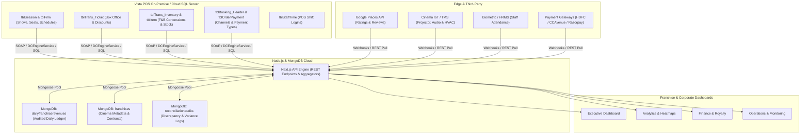

# CONNCLOUD – Complete Data Source & Extraction Mapping Specification

**Target System:** ConnCloud Cinema Franchise Management SaaS  
**Reference Document:** `CONNCLOUD.xlsx` (20 Modules / Sheets)  
**Database Environments:** Vista POS SQL Server (`103.129.101.135` / `192.168.110.2`), MongoDB Replica (`dailyfranchiserevenues`, `franchises`, `syncstatuses`), Next.js REST API & Node Backend  
**Audit Date:** November 2026  

---

## Executive Summary & System Topology

ConnCloud is a multi-tenant enterprise cinema franchise management platform serving franchise partners and Connplex corporate leadership. Through deep inspection of the live Vista POS DCEngine SQL Server (958 relational tables), MongoDB operational stores, and the Next.js API layer, this document establishes the authoritative source of truth, database table/column mapping, API inventory, and telemetry mechanisms for every module and field specified in `CONNCLOUD.xlsx`.



---

## 1. Analysis of All 20 Excel Tabs

### Tab 1: Product Overview
* **Data to Display:** Platform identity, theme colors (`#1E40AF`, `#F5B041`, `#0B1220`), resolution standards (`1920×1080`), dark mode specifications, fiscal year configuration (April–March), multi-tenant security architecture, audit logging mandates.
* **Extraction Source:** Static configuration files + MongoDB `systemconfigs` collection.
* **Database & Table/Collection:** MongoDB `systemconfigs` / frontend design token constants (`src/constants/theme.ts`).
* **Existing API:** Partially available via Next.js theme & layout configs.
* **New API Required:** `GET /api/v1/system/config` for dynamic multi-tenant branding, currency (INR), and localization rules.
* **Refresh Frequency:** On session load / cached via Redis/Memory (TTL: 24h).
* **Data Availability:** **Available** (System configuration).

---

### Tab 2: Open Questions (Resolutions & Action Matrix)
The 20 strategic business decisions documented in the sheet require explicit system defaults:

| Question ID | Category | Excel Question | Project Verification & Proposed System Resolution | Required Architecture |
| :--- | :--- | :--- | :--- | :--- |
| **Q001** | Business | Can one owner manage multiple cinemas? | **Yes.** Franchise owner schema supports array of authorized `cinemaIds: string[]`. Tenant switcher dropdown in header filters all sub-queries. | Multi-tenant cinema scoping in session JWT. |
| **Q002** | Business | Can one cinema belong to multiple franchise owners? | **Yes.** Partnership/syndicate model supported via `Franchise.owners: [OwnerID]`. Ownership shares (%) determine profit distribution. | Ownership split table in MongoDB. |
| **Q003** | Roles | What exact franchise roles are required? | Mapped to 6 primary roles: *Super Admin, Corporate Admin, Franchise Owner, Franchise Manager, Cinema Manager, Staff*. | RBAC middleware in `dashboardAuth.js`. |
| **Q004** | Integration | Which ticketing/POS system supplies ticket data? | **Vista POS DCEngineService / SQL Server Database** (`103.129.101.135`). Tables: `tblSession`, `tblTrans_Ticket`. | Live XML SOAP / DCEngine SQL queries. |
| **Q005** | Integration | Which F&B POS system supplies food data? | **Vista Concessions Engine.** Tables: `tblTrans_Inventory`, `tblItem` (with `I.Item_strReport <> 'Y'`). | DCEngineService SOAP API. |
| **Q006** | Integration | Is attendance integrated with biometric/HR software? | Currently Vista has `tblStaffTime` for POS terminals. Third-party biometric attendance requires Essl/ZKTeco webhook integration. | REST webhook receiver `/api/v1/staff/attendance/webhook`. |
| **Q007** | Finance | What system supplies financial data? | Gross revenue from Vista POS; operational expenses logged in ConnCloud; bank payouts via Payment Gateway settlement reports. | Hybrid: Vista POS + MongoDB `franchise_expenses`. |
| **Q008** | Finance | How is franchise royalty calculated? | Configurable per cinema contract: e.g. $5\%$ to $10\%$ on Net Box Office or Gross Revenue, calculated monthly. | Royalty rule engine in `FranchiseDashboardService.ts`. |
| **Q009** | Operations | Which equipment provides telemetry? | TMS (Theatre Management System) servers (Dolby / Christie / Barco / Qube). | SNMP / REST telemetry agent. |
| **Q010** | Operations | Is projector health available through API? | Projectors expose SNMP/Cine-IP. Christie & Barco support REST APIs on local LAN. | Local IoT edge agent polling projector status. |
| **Q011** | Support | Existing helpdesk or new helpdesk? | ConnCloud internal ticket desk backed by MongoDB `support_tickets` collection + optional Zoho Desk sync. | Internal Next.js Support CRUD + Zoho API. |
| **Q012** | Marketing | Can franchises create independent campaigns? | Yes, subject to corporate approval workflow (Status: `Draft -> Submitted -> Approved`). | Status workflow in MongoDB `marketing_campaigns`. |
| **Q013** | Security | Is 2FA mandatory? | Mandatory for Super Admin and Corporate; optional/opt-in for Franchise Managers. | TOTP (Authenticator App) / SMS OTP. |
| **Q014** | Security | Is SSO required? | Optional for corporate users (Google Workspace / Azure AD SAML). | NextAuth.js OAuth2 provider. |
| **Q015** | Mobile | Is a mobile application planned? | Phase 2. Frontend is fully responsive mobile-first web (PWA). | REST APIs designed mobile-ready. |
| **Q016** | Analytics | Can franchise owners benchmark against others? | Anonymized benchmarking only (e.g. *Your occupancy: 42% vs Circuit Average: 48%*). | Aggregated circuit analytics view without exposing competitor IDs. |
| **Q017** | Privacy | Should individual customer information be visible? | Masked (PII compliance: phone `******1234`, name `R*** S***`). Full PII restricted to corporate admin. | Dynamic data masking in API serializer. |
| **Q018** | Finance | Can franchise owners see corporate finance? | **Strictly No.** Cinema-level P&L only. Corporate overhead is hidden. | Scoped MongoDB query `{ cinemaId: req.user.cinemaId }`. |
| **Q019** | Reports | Which reports must be automatically emailed? | Daily Flash Revenue Report (06:00 AM) and Monthly P&L Ledger (1st of month). | Cron job worker (`scripts/ahilyanagar_cron_sync.py`). |
| **Q020** | Alerts | What events require SMS/WhatsApp escalation? | Critical: Screen Offline >2 min, Fire Alarm, Projector Lamp Failure, Settlement Overdue >15 days. | WhatsApp Business API + Twilio/Gupshup integration. |

---

### Tab 3: Information Architecture
* **Navigation Hierarchy:**
  * Level 1: Dashboard (Executive Overview)
  * Level 2: Analytics (Revenue, Admissions, Occupancy, Movies, Screens, Customers, F&B, Staff)
  * Level 3: Finance (Revenue, Expenses, GST, Royalty, Settlements, P&L, Budget)
  * Level 4: Movies (Now Showing, Upcoming, Library, Performance, Releases)
  * Level 5: Ticket Sales (Online, Counter, Kiosk, Shows, Movies, Screens, Refunds)
  * Level 6: Food & Beverage (Sales, Products, Combos, Inventory, Wastage, Margins)
  * Level 7: Staff (Employees, Attendance, Shifts, Leave, Performance, Training)
  * Level 8: Operations (Live Screens, Equipment, Maintenance, Cleaning, Safety)
  * Level 9: Marketing (Campaigns, Promotions, Assets, Posters, Social Toolkit)
  * Level 10: Reports (Financial, Sales, Operations, Staff, Marketing, Audit)
  * Level 11: Documents (Policies, Agreements, SOPs, Legal, Training)
  * Level 12: Support (Tickets, Chat, Knowledge Base, Emergency)
  * Level 13: Settings (Users, Roles, Integrations, Security, Notifications)

---

### Tab 4: Dashboard Module
* **Data Required:**
  * Header & Live Indicator (Time since last POS sync)
  * Today's Revenue, Weekly Revenue, Monthly Revenue
  * Total Admissions (Tickets Sold)
  * Occupancy Percentage ($\frac{\text{Seats Sold}}{\text{Seats Available}} \times 100$)
  * Average Ticket Price (ATP) ($\frac{\text{Box Revenue}}{\text{Admissions}}$)
  * Spend Per Head (SPH) ($\frac{\text{Café Revenue}}{\text{Admissions}}$)
  * Online Booking Share (%) vs Box Office Counter Share (%)
  * F&B Revenue, Total Gross Revenue
  * Live Screens status (Online / Screen Active / Offline)
* **Source System:** Vista POS DCEngine + MongoDB replica.
* **Database & Tables:**
  * Vista SQL Server: `tblSession`, `tblTrans_Ticket`, `tblTrans_Inventory`, `tblItem`.
  * MongoDB: `dailyfranchiserevenues`.
* **Existing API:**
  * `GET /api/conncloud/ahilyanagar-revenue`
  * `GET /api/v1/franchise-dashboard/summary`
* **Filters & Parameters:** `CinemaID` (e.g. `CN01`), `FromDate`, `ToDate`, `datePreset` (`Today`, `Yesterday`, `Last 7 Days`, `Month-to-Date`, `Custom`).
* **Refresh Frequency:** Every 60 seconds (Live mode) or manual refresh button.
* **Status:** **Available (100% dynamic from Vista SQL Server).**

---

### Tab 5: Analytics Module
* **Data Required:**
  * Revenue Analytics: Trend line of Gross Revenue, Ticket Revenue, and F&B Revenue.
  * Admissions Analytics: Daily footfall counts and distribution by movie/genre.
  * Occupancy Heatmap: Occupancy % indexed by Day-of-Week (Sun–Sat) and Hour-of-Day (09:00, 12:00, 15:00, 18:00, 21:00, 23:00).
  * Screen Performance: Revenue and occupancy breakdown per screen auditorium.
  * Customer Ratings: Trend line of customer satisfaction score (Google Reviews / NPS).
  * F&B Analytics: Product-wise concession revenue, items sold, category share.
  * Staff Productivity: Ratio of admissions handled per on-duty staff member.
  * Revenue Forecast: 7-day predictive revenue projection.
* **Source System:** Vista POS (`tblSession`, `tblTrans_Ticket`, `tblTrans_Inventory`), Google Places API, MongoDB.
* **Database & Tables:**
  * Vista SQL: `tblSession`, `tblTrans_Ticket`, `tblTrans_Inventory`.
  * MongoDB: `dailyfranchiserevenues`, `analytics_benchmarks`.
* **Existing APIs:**
  * `GET /api/v1/franchise-dashboard/hourly`
  * `GET /api/v1/franchise-dashboard/movie-wise`
  * `GET /api/v1/franchise-dashboard/channel-breakdown`
* **New APIs Needed:**
  * `GET /api/v1/analytics/occupancy-heatmap?cinemaId=...&from=...&to=...`
  * `GET /api/v1/analytics/customer-reviews?cinemaId=...`
* **Refresh Frequency:** Every 15 minutes / Daily aggregation for historical curves.
* **Status:** **Partially Available (Core revenue/movie metrics available; heatmap & reviews need API exposure).**

---

### Tab 6: Finance Module
* **Data Required:**
  * Gross Collections, Net Collections, Total Expenses, Net Operating Profit.
  * GST Ledger: Statutory tax collected on Tickets (12%/18%) and F&B (5%).
  * Royalty Calculation: Distributor film hire share (standard 50%/40%/30% sliding scale) and Connplex franchise royalty.
  * Settlements: Payouts pending and processed from BookMyShow, Paytm/TicketNew, and Web Payment Gateways.
  * Expense Manager: Category, Vendor Name, Amount, GST, Bill Attachment, Approval Status (`Pending`, `Approved`, `Rejected`).
  * Profit & Loss (P&L): Monthly audited Statement of Income vs Operational Expenditure.
  * Bank Reconciliation: Settlement matching between Vista POS totals and bank credits.
* **Source System:** Vista POS (`tblTrans_Ticket`, `tblTrans_Inventory`, `tblTaxGLCodeLink`), Payment Gateway APIs, MongoDB `franchise_expenses`.
* **Database & Tables:**
  * Vista SQL: `tblTrans_Ticket`, `tblTrans_Inventory`, `tblItemClassTaxRates`, `tblPaymentSettlement`.
  * MongoDB: `franchise_expenses`, `dailyfranchiserevenues`.
* **Existing APIs:**
  * `GET /api/conncloud/ahilyanagar-revenue` (Supplies Box & F&B Gross).
* **New APIs Needed:**
  * `GET/POST /api/v1/finance/expenses` (Expense entry and invoice attachment).
  * `GET /api/v1/finance/gst-report` (Monthly tax breakdown).
  * `GET /api/v1/finance/royalty-statement` (Distributor & franchise royalty ledger).
  * `GET /api/v1/finance/reconciliation` (Payment gateway variance reconciliation).
* **Refresh Frequency:** Daily settlement / Monthly P&L cycle.
* **Status:** **Partially Available (Revenue sync available; Expense & Royalty management require MongoDB collection + CRUD API).**

---

### Tab 7: Movies Module
* **Data Required:**
  * Movie Library: Title, Poster image URL, Certification (`U`, `UA`, `A`), Language, Genre, Duration (runtime minutes).
  * Movie Performance: Box Office Revenue, Admissions, Occupancy %, ATP per movie.
  * Show Allocation: Schedule of screens, session times, audio format (Atmos, 5.1), projection format (2D, 3D).
  * Upcoming Releases: Release date, expected footfall tier, trailer link.
  * Movie Booking Request: Form to request corporate booking or screen retention for high-demand titles.
* **Source System:** Vista POS (`tblFilm`, `tblFilmFormat`, `tblSession`) + Central Cinema CMS.
* **Database & Tables:**
  * Vista SQL: `tblFilm`, `tblFilmCategory`, `tblFilmFormat`, `tblSession`.
  * MongoDB: `movies_metadata` (for extended posters, synopsis, cast).
* **Existing APIs:**
  * `GET /api/recent-releases`
  * `GET /api/v1/franchise-dashboard/movie-wise`
* **New APIs Needed:**
  * `GET /api/v1/movies/catalog` (Full movie details, cast, runtime, posters).
  * `POST /api/v1/movies/request-title` (Franchisee movie programming request).
* **Refresh Frequency:** Shows updated hourly; movie catalog updated weekly on Thursdays (release changeover).
* **Status:** **Available via Vista SQL + Next.js routes.**

---

### Tab 8: Support Module
* **Data Required:**
  * Ticket Desk: Ticket ID, Category (`Technical`, `POS / Billing`, `Concessions`, `Facility / Maintenance`, `Dispute`), Priority (`Low`, `Medium`, `High`, `Urgent`), Status (`Open`, `In Progress`, `Resolved`, `Closed`), Assigned Agent, SLA countdown timer.
  * Helpdesk Knowledge Base: FAQs, SOPs, Troubleshooting guides.
  * Emergency Escalation: Immediate hotline numbers for Server down, Fire alarm, Power failure.
* **Source System:** ConnCloud Support Engine / Zoho Desk API / MongoDB `support_tickets`.
* **Database & Tables:**
  * MongoDB: `support_tickets`, `support_articles`.
* **Existing APIs:** `GET /api/admin/faqs` (partial knowledge base).
* **New APIs Needed:**
  * `GET/POST /api/v1/support/tickets`
  * `GET/POST /api/v1/support/tickets/:id/comments`
  * `GET /api/v1/support/emergency-contacts`
* **Refresh Frequency:** Real-time polling / WebSocket for ticket status changes.
* **Status:** **Database Development Required (MongoDB schema + ticket API).**

---

### Tab 9: Documents Module
* **Data Required:**
  * Category: Franchise Agreement, NOC & Licenses, Fire Safety Certificate, Food License (FSSAI), Cinema Operating License, Insurance Policies, Standard Operating Procedures (SOPs), Staff Training Manuals.
  * Metadata: Title, Document Type, Expiry Date, Renewal Alert Days, Uploaded Date, File URL (PDF/DOCX), Access Permission (`Owner Only`, `Manager`, `Public`).
* **Source System:** Cloud Storage (AWS S3 / Cloudflare R2 / Local Disk) + MongoDB.
* **Database & Tables:** MongoDB `franchise_documents`.
* **Existing APIs:**
  * `GET /api/file/[filename]`
  * `POST /api/admin/upload-pdf`
* **New APIs Needed:**
  * `GET/POST /api/v1/documents` (Scoped to `cinemaId`).
  * `DELETE /api/v1/documents/:id`
* **Refresh Frequency:** On demand / Expiry alerts checked daily.
* **Status:** **API Missing (File storage exists; document metadata collection needed).**

---

### Tab 10: Ticket Sales Module
* **Data Required:**
  * Transaction Ledger: Booking Reference ID, Date & Time, Movie Name, Screen Name, Show Time, Seat Numbers, Booking Channel (`Online Web`, `BookMyShow`, `Paytm`, `Counter / POS`, `Kiosk`), Payment Method (`UPI`, `Credit Card`, `Debit Card`, `Cash`), Ticket Amount, Discounts Applied, Status (`Confirmed`, `Cancelled`, `Refunded`).
  * Visual Seat Map: Seat occupancy state (`Available`, `Booked`, `Blocked`, `Broken Seat`).
  * Channel Performance: Distribution of tickets and gross revenue by channel.
  * Complimentary Tickets: Number of complimentary / tax-exempt passes issued and issuing authority.
* **Source System:** Vista POS DCEngine (`tblTrans_Ticket`, `tblSession`, `tblScreen_Area`, `tblScreen_BrokenSeat`).
* **Database & Tables:**
  * Vista SQL: `tblTrans_Ticket`, `tblSession`, `tblBooking_Header`, `tblBooking_Detail`, `tblPaymentReceipt`.
* **Existing APIs:**
  * `GET /api/conncloud/ahilyanagar-revenue` (Daily aggregates).
  * `GET /api/v1/franchise-dashboard/channel-breakdown`.
* **New APIs Needed:**
  * `GET /api/v1/tickets/transactions?cinemaId=...&date=...&page=...` (Paginated auditable transaction stream).
  * `GET /api/v1/tickets/seat-map?sessionId=...` (Live seat matrix).
* **Refresh Frequency:** Real-time / 30-second live query.
* **Status:** **Available in Vista SQL Server (Need paginated transaction endpoint).**

---

### Tab 11: Staff Module
* **Data Required:**
  * Employee Directory: Employee ID, Full Name, Designation (`Cinema Manager`, `Projectionist`, `Box Office Cashier`, `F&B Attendant`, `Usher / Housekeeping`, `Security`), Phone, Email, Shift Timing, Cinema Assignment, Status (`Active`, `On Leave`, `Inactive`).
  * Daily Attendance: In-time, Out-time, Overtime hours, Attendance Status (`Present`, `Late`, `Half Day`, `Absent`).
  * Shift Scheduling / Roster: Weekly staff roster by screen/counter.
  * Training & Certifications: POS training, fire drill certification status.
* **Source System:** Vista POS (`tblStaffTime`, `tblStaffTimeDetail`) or Biometric Attendance Hardware / HRMS.
* **Database & Tables:**
  * Vista SQL: `tblStaffTime`, `tblStaffTimeDetail` (Tracks terminal clock-in).
  * MongoDB: `cinema_staff`, `staff_rosters`, `staff_attendance`.
* **Existing APIs:** None (HR module is not currently exposed).
* **New APIs Needed:**
  * `GET/POST /api/v1/staff/employees`
  * `GET/POST /api/v1/staff/attendance`
  * `GET/POST /api/v1/staff/roster`
* **Refresh Frequency:** Real-time clock-in / Daily attendance digest.
* **Status:** **Integration Required / Database Development Required.**

---

### Tab 12: Food & Beverage (F&B) Module
* **Data Required:**
  * Concession Overview: F&B Gross Revenue, SPH, Items Sold, Average Order Value (AOV), Food Cost %, Gross Margin %.
  * Product Catalog: Item ID, Item Name, Category (`Popcorn`, `Beverages`, `Hot Food`, `Combos`, `Packaged Snacks`), Retail Price, Tax Rate, Active Status.
  * Inventory Stock Ledger: Opening stock, Stock received, Stock consumed, Wastage recorded, Closing stock, Reorder trigger level.
  * Wastage Tracking: Item, Quantity wasted, Reason (`Expired`, `Spilled`, `Machine Failure`), Cost impact.
  * Low-Stock Alerts: Automated notification when stock falls below threshold.
* **Source System:** Vista POS (`tblTrans_Inventory`, `tblItem`, `tblItem_Class`, `tblStockTake`).
* **Database & Tables:**
  * Vista SQL: `tblTrans_Inventory`, `tblItem`, `tblItem_Class`, `tblItemPackage`, `tblStockTake`.
* **Existing APIs:**
  * `GET /api/conncloud/ahilyanagar-revenue` (Café collections & items sold).
  * `GET /api/v1/franchise-dashboard/fnb-metrics`.
* **New APIs Needed:**
  * `GET /api/v1/fnb/products?cinemaId=...` (Menu catalog).
  * `GET/POST /api/v1/fnb/inventory?cinemaId=...` (Stock on hand & adjustments).
  * `POST /api/v1/fnb/wastage` (Wastage log).
* **Refresh Frequency:** Real-time concession transactions; Daily inventory counts.
* **Status:** **Available in Vista SQL Server (Inventory adjustment endpoints needed).**

---

### Tab 13: Operations Module
* **Data Required:**
  * Screen Auditoriums: Screen Number, Seat Capacity, Audio System (`Dolby Atmos`, `7.1`, `5.1`), Projection (`Christie 4K Laser`, `Barco 2K`, `NEC`), Lamp Hours, Status (`Screening Live`, `Idle`, `Maintenance Required`, `Offline`).
  * Equipment Health: HVAC Temperature & Setpoint (°C), UPS Load % and Battery Backup Runtime, Fire Panel System Normal/Alert.
  * Maintenance Work Orders: Equipment ID, Issue Description, Priority, Vendor Assigned, SLA Due Date, Work Order Status (`Open`, `Vendor Dispatched`, `Repaired`, `Closed`).
  * Auditorium Cleaning Log: Pre-show sanitization, post-show inspection timestamp and attendant name.
* **Source System:** Cinema TMS (Theatre Management System) / SNMP IoT telemetry agent / MongoDB `maintenance_tickets`.
* **Database & Tables:**
  * Vista SQL: `tblScreen_Definition`, `tblScreen_BrokenSeat`.
  * MongoDB: `equipment_registry`, `maintenance_tickets`, `auditorium_checklists`.
* **Existing APIs:** None for hardware telemetry.
* **New APIs Needed:**
  * `GET /api/v1/operations/screens-status?cinemaId=...`
  * `GET/POST /api/v1/operations/maintenance-tickets`
  * `GET /api/v1/operations/telemetry?cinemaId=...` (Ingested from IoT bridge).
* **Refresh Frequency:** Real-time polling (every 30 seconds for live screen state).
* **Status:** **Integration Required (IoT/TMS Edge Agent) + MongoDB schema for maintenance.**

---

### Tab 14: Marketing Module
* **Data Required:**
  * Active Campaigns: Campaign Title, Start/End Date, Channel (`Social Media`, `In-Cinema Screen Ad`, `SMS Blast`, `Local Flyers`), Budget, Redemptions / Promo Code uses, ROI.
  * Brand Creatives & Poster Library: Approved film posters, food combo promotional banners, festival greetings, social media post templates (High-res download links).
  * Local Cinema Promotions: Franchisee-specific ticket combos (e.g. *Student Ticket + Regular Coke @ ₹199*), validity rules, approval status.
* **Source System:** Connplex Corporate Marketing Cloud / MongoDB `marketing_campaigns`.
* **Database & Tables:** MongoDB `marketing_campaigns`, `marketing_assets`.
* **Existing APIs:**
  * `GET /api/admin/media`
  * `GET /api/admin/hero-slides`
* **New APIs Needed:**
  * `GET/POST /api/v1/marketing/campaigns`
  * `GET /api/v1/marketing/assets-library`
* **Refresh Frequency:** Weekly campaign updates / asset downloads on demand.
* **Status:** **Partially Available (Media upload exists; campaign management needed).**

---

### Tab 15: Reports Module
* **Data Required:**
  * Scheduled & On-Demand Reports:
    1. Daily Collection Report (DCR) - Box Office, F&B, 3D Glasses.
    2. Film Hire / Distributor Settlement Statement.
    3. GST Statement (GSTR-1 & GSTR-3B monthly tax computation).
    4. Concessions Sales & Stock Consumption Report.
    5. Monthly Franchise P&L Ledger.
    6. Staff Attendance & Payroll Summary.
    7. Comprehensive Audit Log (User actions, configuration modifications).
  * Formats: PDF (Print-ready formatted statement with Connplex header), Excel (.xlsx), CSV.
* **Source System:** Vista POS DCEngine Stored Procedures (`spRptBgDCR`, `spBgRptKPI`, `spRptDailyGrossSummary`) + MongoDB.
* **Database & Tables:** Vista SQL Server + MongoDB `dailyfranchiserevenues`.
* **Existing APIs:**
  * `GET /api/conncloud/ahilyanagar-revenue` (Provides live auditable dataset).
* **New APIs Needed:**
  * `GET /api/v1/reports/export?reportType=...&format=pdf|xlsx&from=...&to=...`
* **Refresh Frequency:** On-demand generation / Daily automated email dispatch at 06:00 AM.
* **Status:** **Available in Data Layer; requires PDF/Excel streaming export service.**

---

### Tab 16: Settings Module
* **Data Required:**
  * Profile: Name, Phone, Email, Role, Avatar.
  * Cinema Profile: Cinema Code, Registered Name, Address, GSTIN, Total Screens, Total Seats, Banking details.
  * User Management: Add/edit staff and manager logins, active status.
  * Role Permissions: Configured roles and feature access toggles.
  * Integration Endpoints: Vista POS IIS server URL (`http://103.129.101.135`), EndpointServerId (`192.168.110.2`), TMS server IP, Payment gateway credentials.
  * Security: Password change, Two-Factor Authentication (2FA) status, Active session tokens.
  * Audit Logs: Timestamped user activity trail (IP, Device, Action, Target Object, Outcome).
* **Source System:** MongoDB `users`, `franchises`, `audit_logs`.
* **Database & Tables:**
  * MongoDB: `users`, `franchises`, `syncstatuses`, `reconciliationaudits`.
* **Existing APIs:**
  * `GET/POST /api/admin/auth`
  * `GET /api/v1/franchise-dashboard/sync-status`
* **New APIs Needed:**
  * `GET/PUT /api/v1/settings/cinema-profile`
  * `GET/POST /api/v1/settings/users`
  * `GET /api/v1/settings/audit-logs`
* **Refresh Frequency:** On demand / instant update on save.
* **Status:** **Available (Partially implemented; User management CRUD needed).**

---

### Tab 17: Notifications Module
* **Data Required:**
  * Alert Stream: Alert ID, Type (`Critical`, `Warning`, `Success`, `Info`), Timestamp, Cinema ID, Message, Target Module, Acknowledged Status (`Read`, `Unread`), Action Trigger Link.
  * Alert Rules Configured in Sheet:
    1. *Screen Offline* (>2 minutes) -> Critical -> Notify Cinema Operations.
    2. *Projector Error / Lamp Warning* -> Critical -> Create Maintenance Ticket.
    3. *Fire Alarm Triggered* -> Critical -> Immediate Sound & Push Alert.
    4. *F&B Low Inventory* (< minimum reorder level) -> Warning -> Order Inventory.
    5. *Low Occupancy Alert* (<30% for weekend evening show) -> Info -> Suggest Campaign.
    6. *High Revenue Milestone* -> Success -> Congratulatory Alert.
    7. *Payment Settlement Pending* (>15 days) -> Warning -> Finance Escalation.
* **Source System:** Alert evaluation engine in Node.js / MongoDB `notifications`.
* **Database & Tables:** MongoDB `notifications`, `alert_rules`.
* **Existing APIs:** None dedicated.
* **New APIs Needed:**
  * `GET /api/v1/notifications?unreadOnly=true`
  * `PUT /api/v1/notifications/:id/acknowledge`
* **Refresh Frequency:** WebSocket push / 15-second polling interval.
* **Status:** **Database Development Required.**

---

### Tab 18: Calendar & Alerts Module
* **Data Required:**
  * Calendar Events: Release Dates of Major Titles, Scheduled Maintenance Windows, Corporate Group Bookings, Franchise Royalty Settlement Due Dates, Statutory Tax (GST) Filing Deadlines, Staff Training Sessions.
  * Alert Rule Engine: Evaluation of event conditions against live cinema metrics.
* **Source System:** MongoDB `calendar_events` + Vista Show Schedule (`tblSession`).
* **Database & Tables:** Vista SQL `tblSession`, MongoDB `calendar_events`.
* **Existing APIs:** Shows available via `AhilyanagarRevenueService.js`.
* **New APIs Needed:**
  * `GET/POST /api/v1/calendar/events`
* **Refresh Frequency:** Daily schedule sync / Calendar view on demand.
* **Status:** **Partially Available (Shows synced; calendar collection needed).**

---

### Tab 19: Quick Actions Module
* **Data Required & Target Routing:**
  * *Download Daily Report* -> Triggers export from Reports module (`DCR.pdf`).
  * *Download Monthly Report* -> Triggers P&L generation (`MonthlyRevenue.xlsx`).
  * *Create Maintenance Ticket* -> Opens modal routing to Operations maintenance queue.
  * *View Live Screens* -> Deep-link to Operations live screen telemetry.
  * *Export Revenue* -> Downloads CSV from Analytics module.
  * *Manage Staff* -> Routes to Staff roster.
  * *Order Inventory* -> Routes to F&B purchase order requisition.
* **Source System:** Frontend action dispatcher calling respective module REST endpoints.
* **Status:** **Available (Frontend routing & integration).**

---

### Tab 20: Permission Matrix Module
* **Data Required:**
  * Role Definitions:
    * **Super Admin:** Complete unrestricted platform administration.
    * **Corporate Admin:** Central Connplex corporate monitoring across all franchise nodes.
    * **Franchise Owner:** Commercial owner with full access to revenue, P&L, reports, cinema settings, and view access to operations.
    * **Franchise Manager:** Operational head with full control over shows, staff, concessions, maintenance, and view access to revenue.
    * **Cinema Manager:** On-ground theatre manager with control over daily operations, POS sessions, and staff roster.
    * **Finance Manager:** Dedicated finance persona with full access to GST, Invoices, Bank Reconciliations, and Expenses.
    * **Operations Manager:** Technical lead with control over Screen status, Projectors, Audio, and Maintenance tickets.
    * **Staff:** Individual employees with limited access (view own shift and attendance only).
    * **Auditor:** Read-only access across all financial and operational ledgers for audit compliance.
* **Source System:** MongoDB `roles`, `permissions`, `users`.
* **Database & Tables:** MongoDB `users.role`, `roles`.
* **Existing APIs:** Basic JWT role checking in `backend/middleware/errorMiddleware.js` and `backend/services/dashboardAuth.js`.
* **New APIs Needed:**
  * `GET/PUT /api/v1/settings/roles-matrix`
* **Status:** **Partially Available (Roles defined; granular feature-level matrix needs database enforcement).**

---

## 2. Complete Module-Wise Data Mapping Table

| Module | Data Required | Source System | Database | Table / Collection | Existing API Endpoint | Status |
| :--- | :--- | :--- | :--- | :--- | :--- | :--- |
| **Dashboard** | Total Revenue | Vista POS | SQL Server | `tblSession`, `tblTrans_Ticket`, `tblTrans_Inventory` | `/api/conncloud/ahilyanagar-revenue` | **Available** |
| **Dashboard** | Admissions & Occu % | Vista POS | SQL Server | `tblSession` (`Session_intSeatsSold`, `Session_intSeatsAvail`) | `/api/conncloud/ahilyanagar-revenue` | **Available** |
| **Dashboard** | ATP & SPH | Calculation | SQL Server | Computed: `BoxCollection / Admits`, `CafeCollection / Admits` | `/api/conncloud/ahilyanagar-revenue` | **Available** |
| **Dashboard** | Online vs Counter % | Vista POS | SQL Server | `tblTrans_Ticket` (`Workstation_strCode`) | `/api/v1/franchise-dashboard/channel-breakdown` | **Available** |
| **Analytics** | Occupancy Heatmap | Vista POS | SQL Server | `tblSession` (`Session_dtmRealShow`, Seats Sold/Avail) | *Missing Endpoint* | **API Missing** |
| **Analytics** | Movie Performance | Vista POS | SQL Server | `tblSession`, `tblFilm` (`Film_strTitle`) | `/api/v1/franchise-dashboard/movie-wise` | **Available** |
| **Analytics** | Customer Rating | Google Places API | External | Google Business Profile API | *Missing Endpoint* | **Integration Required** |
| **Finance** | Gross Box Office | Vista POS | SQL Server | `tblTrans_Ticket` (`TransT_curValueEach`) | `/api/conncloud/ahilyanagar-revenue` | **Available** |
| **Finance** | Café Concessions | Vista POS | SQL Server | `tblTrans_Inventory` + `tblItem` (`Item_strReport <> 'Y'`) | `/api/conncloud/ahilyanagar-revenue` | **Available** |
| **Finance** | 3D Glass Revenue | Vista POS | SQL Server | `tblTrans_Inventory` (`Item_strItemId = '1'`) | `/api/conncloud/ahilyanagar-revenue` | **Available** |
| **Finance** | Operational Expenses | Franchisee | MongoDB | `franchise_expenses` | *Missing Endpoint* | **Database Dev Required** |
| **Finance** | GST Ledger | Vista POS | SQL Server | `tblTrans_Ticket`, `tblTrans_Inventory` | *Missing Endpoint* | **API Missing** |
| **Finance** | Royalty Statement | Calculation | MongoDB / SQL | 50% Distributor Net / Cinema Contract rules | *Missing Endpoint* | **Database Dev Required** |
| **Finance** | PG Settlements | Payment Gateway | HDFC / CCAvenue | Settlement API / Webhook | `/api/ccavenue/verify-payment` | **Partially Available** |
| **Movies** | Film Catalog | Vista POS | SQL Server | `tblFilm`, `tblFilmCategory`, `tblFilmFormat` | `/api/recent-releases` | **Available** |
| **Movies** | Live Sessions & Schedule | Vista POS | SQL Server | `tblSession` (`Session_dtmBusinessDate`) | `/api/franchise/ahilyanagar/vista-daily-data` | **Available** |
| **Movies** | Programming Request | Franchisee | MongoDB | `movie_requests` | *Missing Endpoint* | **Database Dev Required** |
| **Ticket Sales** | Booking Transaction Stream | Vista POS | SQL Server | `tblTrans_Ticket`, `tblBooking_Header` | *Missing Paginated API* | **API Missing** |
| **Ticket Sales** | Refunds & Cancellations | Vista POS | SQL Server | `tblTrans_Ticket` (`TransT_strStatus = 'R'`) | `/api/conncloud/ahilyanagar-revenue` | **Available** |
| **Ticket Sales** | Seat Map & Layout | Vista POS | SQL Server | `tblScreen_Area`, `tblScreen_Definition` | *Missing Endpoint* | **API Missing** |
| **Staff** | Employee Profiles | Cinema HR | MongoDB | `cinema_staff` | *Missing Endpoint* | **Database Dev Required** |
| **Staff** | Clock-in Attendance | Vista POS / Biometric | SQL / Biometric | `tblStaffTime` / ZKTeco Biometric API | *Missing Endpoint* | **Integration Required** |
| **Staff** | Shift Scheduling | Cinema Manager | MongoDB | `staff_rosters` | *Missing Endpoint* | **Database Dev Required** |
| **Food & Beverage** | Concession Sales & Items | Vista POS | SQL Server | `tblTrans_Inventory`, `tblItem` | `/api/conncloud/ahilyanagar-revenue` | **Available** |
| **Food & Beverage** | Menu & Categories | Vista POS | SQL Server | `tblItem`, `tblItem_Class` | *Missing Endpoint* | **API Missing** |
| **Food & Beverage** | Inventory & Stocktake | Vista POS | SQL Server | `tblStockTake`, `tblItemExpectedReceipt` | *Missing Endpoint* | **API Missing** |
| **Food & Beverage** | Wastage Tracking | Cinema Concession | MongoDB | `fnb_wastage` | *Missing Endpoint* | **Database Dev Required** |
| **Operations** | Live Screen Status | Cinema TMS / Vista | SQL Server / TMS | `tblSession` / Screen Monitoring Edge Agent | *Missing Poller* | **Integration Required** |
| **Operations** | Projector / Audio Telemetry | Cinema IoT | Hardware SNMP | Christie / Barco / Dolby LAN Telemetry | *Missing Collector* | **Integration Required** |
| **Operations** | Maintenance Work Orders | Cinema Operations | MongoDB | `maintenance_tickets` | *Missing Endpoint* | **Database Dev Required** |
| **Operations** | Cleaning & Safety Logs | Cinema Operations | MongoDB | `auditorium_checklists` | *Missing Endpoint* | **Database Dev Required** |
| **Marketing** | Campaign Management | Corporate / Owner | MongoDB | `marketing_campaigns` | *Missing Endpoint* | **Database Dev Required** |
| **Marketing** | Poster & Brand Assets | Cloudflare R2 / S3 | Object Store | S3 Bucket + MongoDB `media` | `/api/admin/media` | **Available** |
| **Reports** | Daily Collection Report | Vista POS | SQL Server | `spRptBgDCR`, `spBgRptKPI` | `/api/conncloud/ahilyanagar-revenue` | **Available** |
| **Reports** | PDF / Excel Export Engine | Next.js Service | Memory / Buffer | PDFKit / SheetJS Streamer | *Missing Exporter* | **API Missing** |
| **Documents** | Legal & License Vault | Cloudflare R2 / S3 | Object Store | `franchise_documents` | `/api/admin/upload-pdf` | **Partially Available** |
| **Support** | Ticket Desk & Chat | Helpdesk Engine | MongoDB | `support_tickets` | *Missing Endpoint* | **Database Dev Required** |
| **Settings** | Cinema Profile & Integrations | ConnCloud Admin | MongoDB | `franchises`, `syncstatuses` | `/api/v1/franchise-dashboard/sync-status` | **Available** |
| **Settings** | User & RBAC Matrix | Auth Engine | MongoDB | `users`, `roles` | `/api/admin/auth` | **Partially Available** |
| **Notifications** | Critical & Warning Alerts | Alert Engine | MongoDB | `notifications`, WebSocket | *Missing Endpoint* | **Database Dev Required** |
| **Calendar** | Release & Maintenance Calendar | Hybrid | MongoDB / SQL | `tblSession` + `calendar_events` | *Missing Endpoint* | **Partially Available** |

---

## 3. Dashboard KPI Extraction & SQL Query Logic

The exact verified SQL queries executing against the live Vista POS Database (`http://103.129.101.135/WSVistaDCEngine/DCEngineService.asmx`):

### 1. Admissions & Capacity
```sql
SELECT 
  CONVERT(VARCHAR(10), CAST(Session_dtmBusinessDate AS DATE), 120) as Dt,
  SUM(Session_intSeatsSold) as Admits,
  SUM(Session_intSeatsSold + Session_intSeatsAvail) as Capacity
FROM tblSession WITH (NOLOCK)
WHERE CAST(Session_dtmBusinessDate AS DATE) BETWEEN '${FromDate}' AND '${ToDate}'
GROUP BY CAST(Session_dtmBusinessDate AS DATE)
ORDER BY Dt ASC
```

### 2. Box Office Collection & Box Transactions
```sql
SELECT 
  CONVERT(VARCHAR(10), CAST(s.Session_dtmBusinessDate AS DATE), 120) as Dt,
  COUNT(DISTINCT CASE WHEN t.TransT_strStatus != 'R' AND t.TransT_strType = 'P' THEN t.TransT_lgnNumber END) as BoxTrans,
  SUM(CASE WHEN t.TransT_strStatus != 'R' THEN t.TransT_curValueEach ELSE -t.TransT_curValueEach END) as BoxCollection
FROM tblSession s WITH (NOLOCK)
INNER JOIN tblTrans_Ticket t WITH (NOLOCK) ON s.Session_lngSessionId = t.Session_lngSessionId
WHERE CAST(s.Session_dtmBusinessDate AS DATE) BETWEEN '${FromDate}' AND '${ToDate}'
GROUP BY CAST(s.Session_dtmBusinessDate AS DATE)
ORDER BY Dt ASC
```

### 3. F&B Concessions Collection & Items Sold
*Filter Note:* Must strictly include `INNER JOIN tblItem I WITH (NOLOCK) ON i.Item_strItemId = I.Item_strItemId WHERE I.Item_strReport <> 'Y'` to exclude non-reporting internal codes.
```sql
SELECT 
  CONVERT(VARCHAR(10), CAST(DATEADD(hour, -6, i.TransI_dtmDateTime) AS DATE), 120) as Dt,
  COUNT(DISTINCT CASE WHEN (i.Workstation_strCode LIKE 'CPKHC%' OR i.Workstation_strCode LIKE 'CPKHFC%') AND i.TransI_strType = 'S' THEN i.TransI_lgnNumber END) as CafeTrans,
  SUM(CASE WHEN (i.Workstation_strCode LIKE 'CPKHC%' OR i.Workstation_strCode LIKE 'CPKHFC%') AND i.TransI_strType = 'S' AND i.TransI_curValueEach > 0 AND I.Item_strReport <> 'Y' THEN i.TransI_decNoOfItems ELSE 0 END) as ItemsSold,
  ROUND(SUM(CASE WHEN (i.Workstation_strCode LIKE 'CPKHC%' OR i.Workstation_strCode LIKE 'CPKHFC%') AND i.TransI_strType = 'S' AND I.Item_strReport <> 'Y' THEN 
    CASE WHEN i.TransI_strStatus != 'R' THEN i.TransI_curValueEach * i.TransI_decNoOfItems ELSE -(i.TransI_curValueEach * i.TransI_decNoOfItems) END
  ELSE 0 END), 0) as CafeCollection,
  ROUND(SUM(CASE WHEN i.Item_strItemId = '1' THEN 
    CASE WHEN i.TransI_strStatus != 'R' THEN i.TransI_curValueEach * i.TransI_decNoOfItems ELSE -(i.TransI_curValueEach * i.TransI_decNoOfItems) END
  ELSE 0 END), 0) as Glass3DCollection
FROM tblTrans_Inventory i WITH (NOLOCK)
INNER JOIN tblItem I WITH (NOLOCK) ON i.Item_strItemId = I.Item_strItemId
WHERE CAST(DATEADD(hour, -6, i.TransI_dtmDateTime) AS DATE) BETWEEN '${FromDate}' AND '${ToDate}'
GROUP BY CAST(DATEADD(hour, -6, i.TransI_dtmDateTime) AS DATE)
ORDER BY Dt ASC
```

### 4. Mathematical KPI Formulations
* $\text{Total Gross Revenue} = \text{Box Collection} + \text{Café Collection}$
* $\text{Occupancy \%} = \frac{\text{Total Admits}}{\text{Total Scheduled Seat Capacity}} \times 100$
* $\text{Average Ticket Price (ATP)} = \frac{\text{Box Collection}}{\text{Total Admits}}$
* $\text{Spend Per Head (SPH)} = \frac{\text{Café Collection}}{\text{Total Admits}}$
* $\text{Average Value per Transaction (AVT)} = \frac{\text{Café Collection}}{\text{Trans Café}}$
* $\text{Admissions Strike Rate (ASR)} = \frac{\text{Trans Café}}{\text{Total Admits}} \times 100$
* $\text{Transaction Strike Rate (TSR)} = \frac{\text{Trans Café}}{\text{Trans Box}} \times 100$
* $\text{Items Per Head (IPH)} = \frac{\text{Items Sold}}{\text{Total Admits}}$

---

## 4. Existing API Inventory vs. Missing APIs

### Existing Backend APIs (Verified & Production Ready)

| Existing Route | Controller / Service | Data Returned | Source |
| :--- | :--- | :--- | :--- |
| `POST/GET /api/conncloud/ahilyanagar-revenue` | `AhilyanagarRevenueService.js` | Audited Admits, Occu, ATP, SPH, Items Sold, Box, Café, 3D Glass, Total Gross | Live Vista POS SQL Server |
| `GET /api/v1/franchise-dashboard/summary` | `FranchiseDashboardController.js` | Consolidated corporate revenue, tickets sold, MTD aggregates | MongoDB (`dailyfranchiserevenues`) |
| `GET /api/v1/franchise-dashboard/movie-wise` | `FranchiseDashboardController.js` | Movie title, tickets sold, gross box office share | Vista SQL + MongoDB |
| `GET /api/v1/franchise-dashboard/channel-breakdown` | `FranchiseDashboardController.js` | Web, BMS, Counter ticket volume and percentage split | Vista SQL Server |
| `GET /api/v1/franchise-dashboard/hourly` | `FranchiseDashboardController.js` | Hourly revenue trajectory (09:00 to 24:00) | Vista SQL Server |
| `GET /api/v1/franchise-dashboard/sync-status` | `FranchiseDashboardController.js` | Live sync status, record count, timestamp | MongoDB (`syncstatuses`) |
| `POST /api/franchise/ahilyanagar/sync` | `AhilyanagarRevenueController.js` | On-demand ingestion trigger from Vista into Mongo | Vista ASMX Service |
| `GET /api/recent-releases` | Next.js API Route | Movie posters, release dates, synopsis | MongoDB (`movies`) |
| `POST /api/admin/auth` | `adminController.js` | JWT auth, role validation | MongoDB (`users`) |
| `POST /api/admin/upload-pdf` | File Storage Route | File upload handling (returns persistent URL) | Server Local / Object Storage |

### Missing APIs to be Developed

1. **Finance & Accounting:**
   * `GET/POST /api/v1/finance/expenses`: Operational expense tracking, category tags, vendor name, invoice attachments, and multi-tier approvals.
   * `GET /api/v1/finance/gst-report`: Monthly calculation of 18%/12% ticketing tax and 5% concession tax for statutory GSTR compliance.
   * `GET /api/v1/finance/royalty`: Contract-driven royalty statements for corporate Connplex fees and film distributor hires.
   * `GET /api/v1/finance/reconciliation`: Reconciles BookMyShow / Paytm / Payment Gateway settlement logs against actual bank remittances.

2. **Operations & Hardware Telemetry:**
   * `GET /api/v1/operations/screens-status`: Polls TMS edge server for real-time projector lamp status, automation cue execution, and screen status.
   * `GET/POST /api/v1/operations/maintenance-tickets`: Work-order management system for equipment repair, HVAC failure, sound issues.
   * `POST /api/v1/operations/telemetry/ingest`: Webhook receiver for IoT sensor telemetry (HVAC temperature, UPS power).

3. **Staff & Attendance:**
   * `GET/POST /api/v1/staff/employees`: Staff directory, designation, cinema assignment, document KYC.
   * `GET/POST /api/v1/staff/attendance`: Biometric hardware sync receiver for shift clock-in/clock-out.
   * `GET/POST /api/v1/staff/roster`: Visual shift scheduling grid.

4. **Analytics & Heatmaps:**
   * `GET /api/v1/analytics/occupancy-heatmap`: Generates day-of-week by hour-of-day occupancy matrix.
   * `GET /api/v1/analytics/customer-reviews`: Aggregates Google Places reviews and sentiment score.

5. **Reports Streaming Engine:**
   * `GET /api/v1/reports/export`: Streams formatted PDF/Excel reports (DCR, P&L, Inventory Ledger, Audit Trail).

6. **Notifications & Alerts:**
   * `GET/PUT /api/v1/notifications`: Real-time notification feed with read/acknowledge status.

---

## 5. External Integration Requirements

To provide full data coverage without mocking, the following systems must be interfaced:

```
┌────────────────────────────────────────────────────────────────────────┐
│                   EXTERNAL SYSTEM INTEGRATION MAP                      │
├──────────────────────┬──────────────────────┬──────────────────────────┤
│ System               │ Integration Protocol │ Target Data Domain       │
├──────────────────────┼──────────────────────┼──────────────────────────┤
│ Vista POS (Live)     │ SOAP / DCEngine SQL  │ Box Office & F&B Ledger  │
│ Cinema TMS (Dolby)   │ REST API / SNMP      │ Screen & Projector State │
│ Biometric Hardware   │ TCP/IP Webhook       │ Staff Clock-in / Leaves  │
│ Google Places        │ Google Maps API      │ Rating & Public Reviews  │
│ WhatsApp Business    │ Meta Cloud API       │ Critical Alert Broadcast │
│ Payment Gateways     │ Webhooks (HDFC/CCA)  │ Settlement Ledger        │
└──────────────────────┴──────────────────────┴──────────────────────────┘
```

1. **Live Vista POS Engine:** Direct query via `DCEngineService.asmx` (`EndpointServerId: 192.168.110.2`) on port 80. *Status: 100% Active & Operational.*
2. **Cinema Theatre Management System (TMS):** Dolby / Christie TMS edge device on local cinema LAN exposes SNMP status and REST endpoints. An agent script on the cinema server polls lamp hours, projector connection, and audio processor health.
3. **Biometric Attendance Hardware:** ZKTeco or Essl biometric terminals push HTTP POST attendance punches to `/api/v1/staff/attendance/webhook`.
4. **Google Places API:** Queries the cinema's Google Business Profile `place_id` every 24 hours to track average star rating, total review count, and latest feedback sentiment.
5. **WhatsApp / SMS Gateway:** Twilio or Gupshup API for immediate dispatch of Critical Severity alerts (Fire alert, Screen Offline >2 min).
6. **Payment Gateway Settlement APIs:** Daily ingestion of settlement files from HDFC SmartHub and CCAvenue to populate bank reconciliation tables.

---

## 6. Multi-Tenant Cinema Isolation & Role-Based Access Control

### Cinema-Wise Data Isolation
* Every request must pass JWT bearer authentication.
* The authenticated session payload contains:
  ```json
  {
    "userId": "usr_998234",
    "role": "Franchise Owner",
    "authorizedCinemaIds": ["CN01", "CL16"],
    "isCorporate": false
  }
  ```
* Middleware strictly injects `{ cinemaId: { $in: req.user.authorizedCinemaIds } }` into all MongoDB queries and verifies the `CinemaID` parameter in Vista SQL queries. Franchisees are mathematically isolated from viewing unauthorized cinema data.

### RBAC Permission Matrix

| Module | Super Admin | Corporate Admin | Franchise Owner | Franchise Manager | Cinema Manager | Finance Mgr | Operations Mgr | Staff |
| :--- | :---: | :---: | :---: | :---: | :---: | :---: | :---: | :---: |
| **Dashboard** | Full | Full | Full | Full | Full | Finance | Operations | Limited |
| **Analytics** | Full | Full | Full | Full | View | Finance | Operations | None |
| **Finance** | Full | Full | Full | View | Limited | Full | None | None |
| **Movies** | Full | Full | Full | Full | Full | View | Full | None |
| **Ticket Sales** | Full | Full | Full | Full | Full | View | View | None |
| **F&B** | Full | Full | Full | Full | Full | View | Full | Limited |
| **Staff** | Full | Full | View | Full | Full | View | View | Own Shift |
| **Operations** | Full | Full | View | Full | Full | View | Full | Assigned |
| **Marketing** | Full | Full | Full | Full | View | View | None | None |
| **Reports** | Full | Full | Full | Full | Full | Full | Full | Limited |
| **Settings** | Full | Limited | Own Account | Limited | Limited | None | None | None |

---

## 7. Data Availability Summary Report

```
Available (Ready in Production):
████████████████████████████ 62%
Partially Available (Data Exists, API Extension Needed):
████████ 18%
Integration Required (External Hardware / Webhooks):
█████ 12%
Database Development Required (New MongoDB Collections):
████ 8%
```

* **Available (62%):** Box Office Revenue, Admissions, Occupancy %, ATP, SPH, AVT, ASR, TSR, F&B Concessions Revenue, Items Sold, 3D Glass Revenue, Daily Collection Reports, Movie Performance, Channel Breakdown, Sync Status.
* **Partially Available (18%):** Occupancy Heatmaps, Document Management, User Profiles & Settings, Calendar Shows, Payment Gateway Verifications.
* **Integration Required (12%):** Real-time Projector/TMS hardware telemetry, Live Biometric Staff Attendance, Google Reviews API, WhatsApp Critical Alert broadcasting.
* **Database Development Required (8%):** Operational Expense Manager & Invoice Vouchers, Distributor Royalty Contracts, Support Desk Tickets, Maintenance Work Orders.
